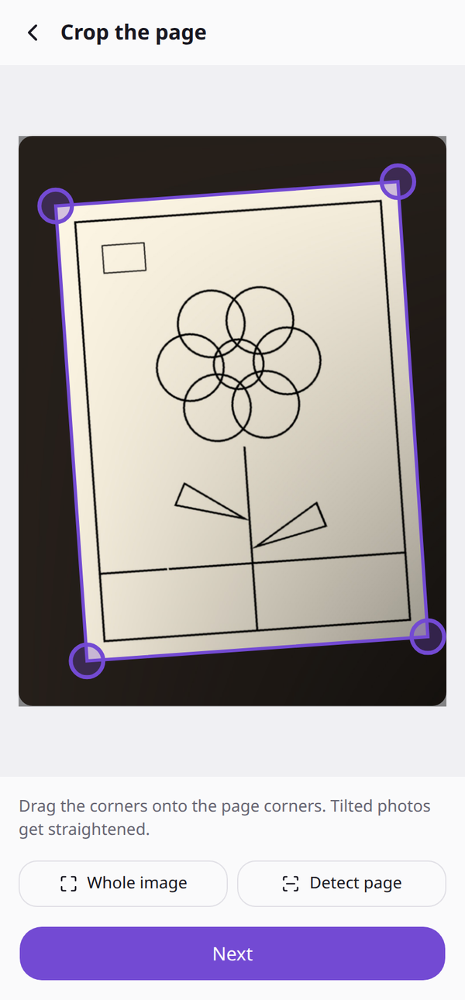
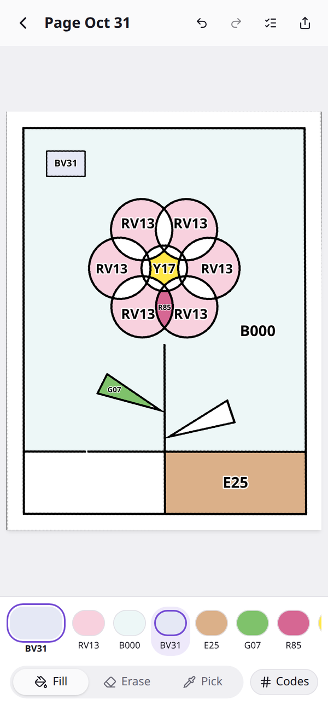
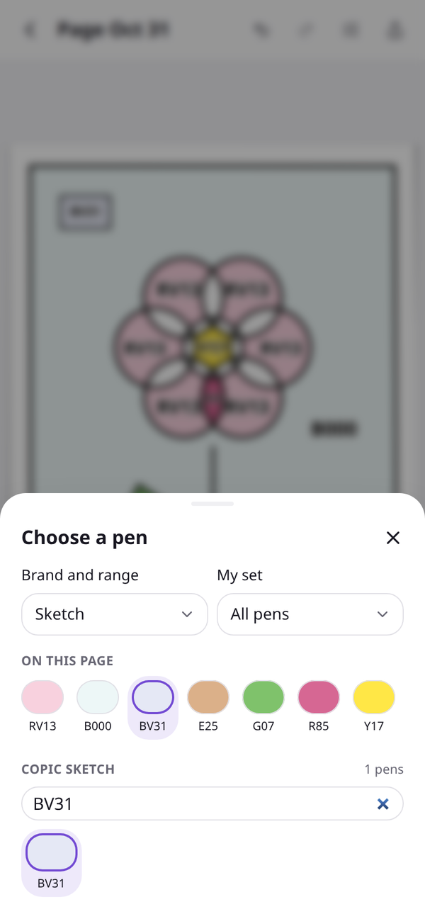
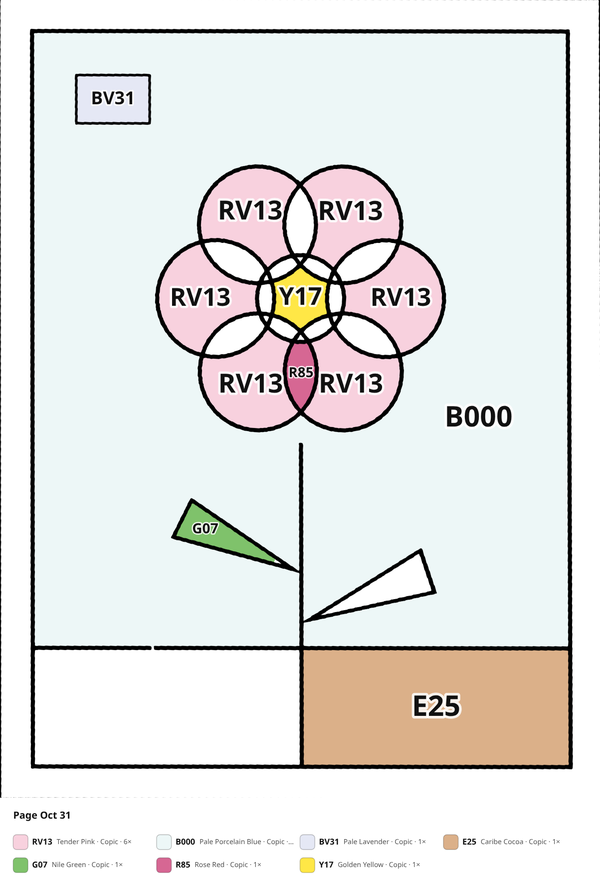

<h1 align="center">Tintplan</h1>

<p align="center">
  <em>Plan your coloring pages with real pen colors. Take a photo of a coloring page, tap areas to fill them with your markers or pencils, and get the pen code written into every area. Runs in the browser, installs as a PWA and ships as an Android app. Works offline. English and German.</em>
</p>

<p align="center"><a href="https://spenhouet.com/tintplan/">Open the web app</a> · <a href="https://github.com/Spenhouet/tintplan/releases/latest">Download the Android app</a></p>

<p align="center">
  
  
  
  
</p>

## How it works

1. **Photo.** Take a photo of the page or pick one from the gallery.
2. **Crop.** The page is found on a darker background; drag the corners to adjust. Tilted photos are straightened.
3. **Clean up.** Shadows and uneven light are removed, lines become black and paper white. Turn the strength up for faint lines, or choose _Use as is_ for scans and earlier exports. Gap closing stops color from leaking through small breaks in lines.
4. **Color.** Pick a brand and pen, then tap areas. The pen code is written where the area has the most room, and smaller in tight spots.
5. **Export.** Save or share a PNG with or without codes, plus a list of the pens used. The PNG carries the page, so importing it again opens it for editing.

## Features

- **17 palettes, 3,273 pens**: Copic Sketch, Ciao and Classic; Ohuhu Honolulu, Oahu and Kaala (new codes, old codes searchable); DecoTime; Faber-Castell Polychromos, Albrecht Dürer, Goldfaber and Black Edition; Caran d'Ache Luminance, Pablo, Supracolor, Museum Aquarelle and Neocolor II; Finecolour.
- **Your set**: filter the picker to the set you own (for example Polychromos 60 or Copic Sketch 72 A).
- **Pen picker** with search by code, name or hex, pens already on the page and recently used pens. A quick strip under the page switches pens with one tap.
- **Tools**: fill, erase, pick a pen from an area, undo and redo, replace or remove a pen everywhere.
- **Pens used** list with how many areas each pen fills, a shopping list for your coloring session.
- **Pinch to zoom** and drag to pan; mouse wheel on desktop.
- **Private.** No account, no server. Photos and pages stay on the device.

Pen colors are approximations sampled from the makers' color charts. Real ink and pencil look different on paper, so swatch your pens to be sure.

## Android app

The APK bundles the web app and runs fully offline. Each release on GitHub has a signed APK built by the [Android Release](.github/workflows/android-release.yml) workflow.

### Install via Obtainium

[Obtainium](https://github.com/ImranR98/Obtainium) installs apps from their GitHub releases and keeps them updated.

1. Install Obtainium from its [releases page](https://github.com/ImranR98/Obtainium/releases) or [F-Droid](https://f-droid.org/packages/dev.imranr.obtainium.fdroid/).
2. Tap **Add App**, enter `https://github.com/Spenhouet/tintplan` and tap **Add**.
3. Tap **Install**.

Or [add Tintplan to Obtainium directly](https://apps.obtainium.imranr.dev/redirect.html?r=obtainium://add/https://github.com/Spenhouet/tintplan) from your Android device.

## Development

```sh
bun install
bun run dev
```

See [CLAUDE.md](CLAUDE.md) for the code layout and [DESIGN.md](DESIGN.md) for the UI rules. `bunx vitest --run` runs the unit tests, `bunx playwright test` the end-to-end test.

## Pen data

The pen colors come from MIT-licensed projects; see [THIRD_PARTY.md](THIRD_PARTY.md). To add a brand, add a converter to `scripts/import-pens.ts` that writes the same `Palette` format (`src/lib/pens/types.ts`).

## License

[MIT](LICENSE)
